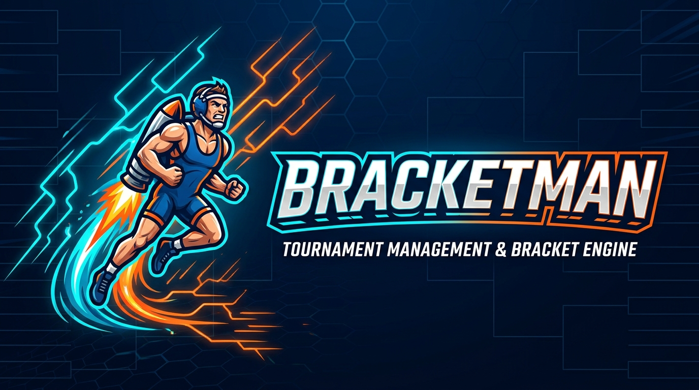
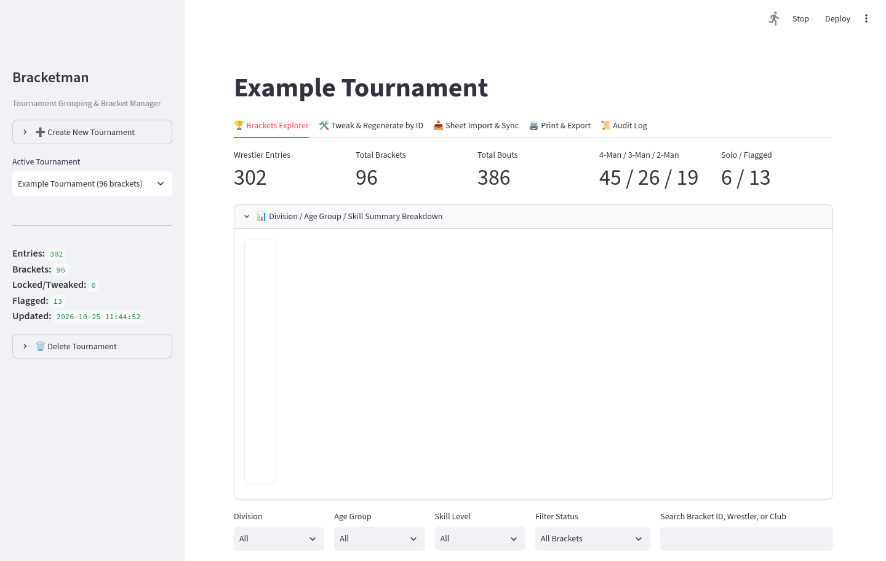
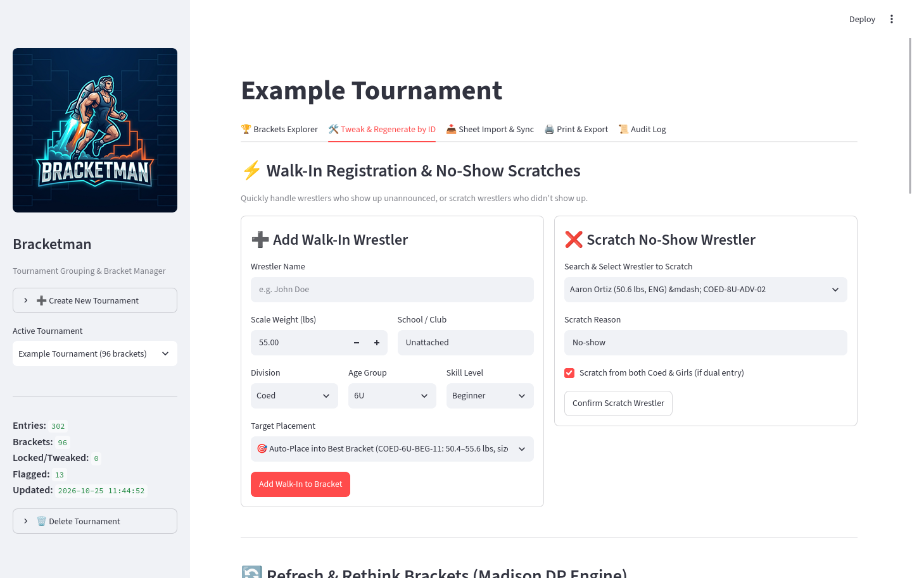
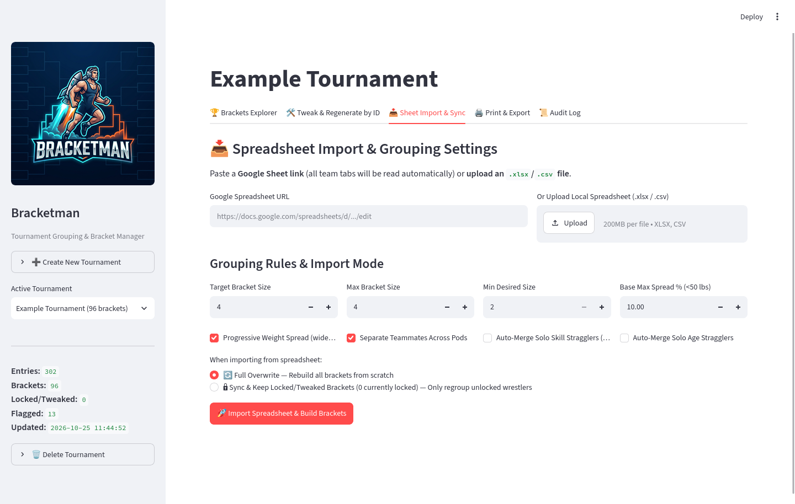
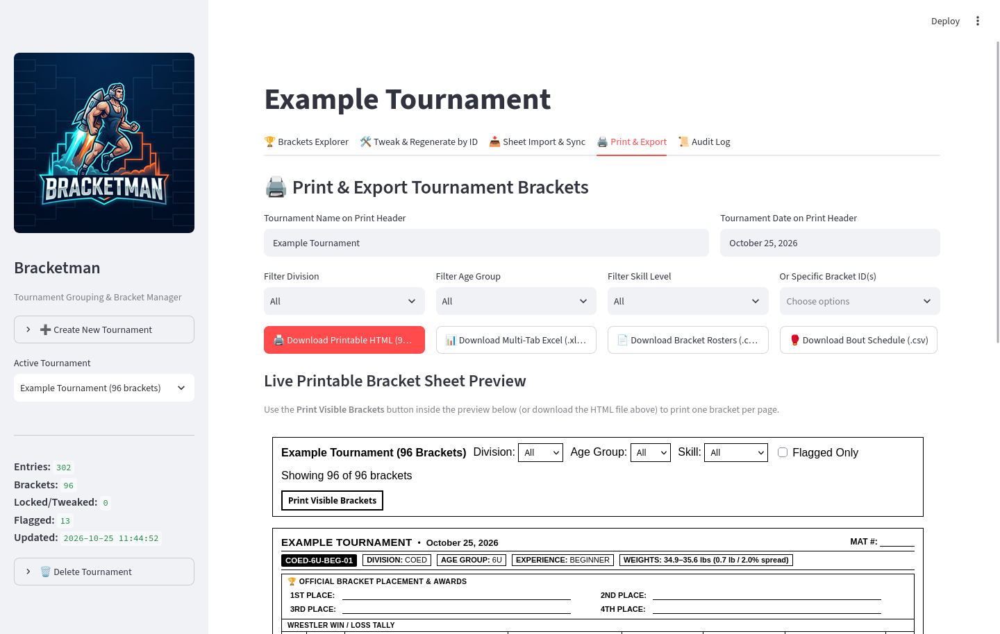
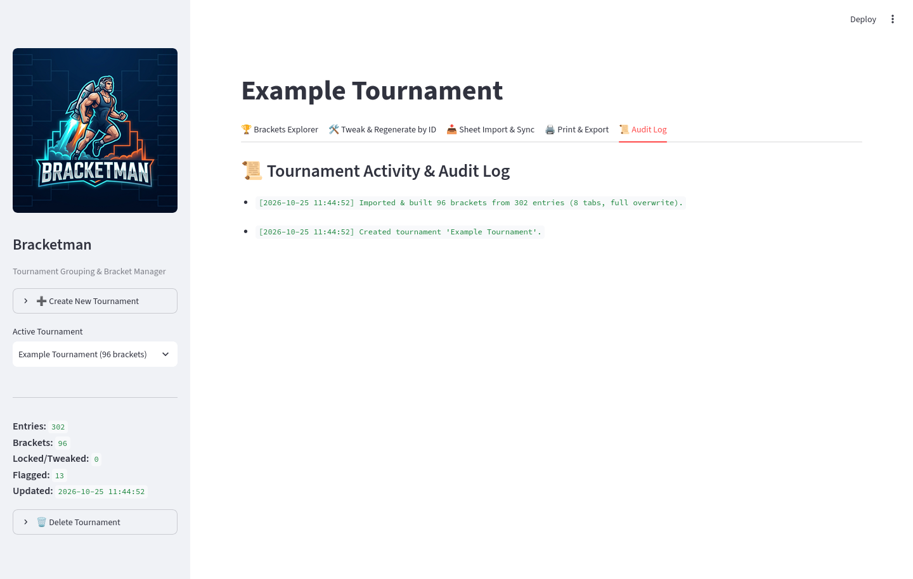
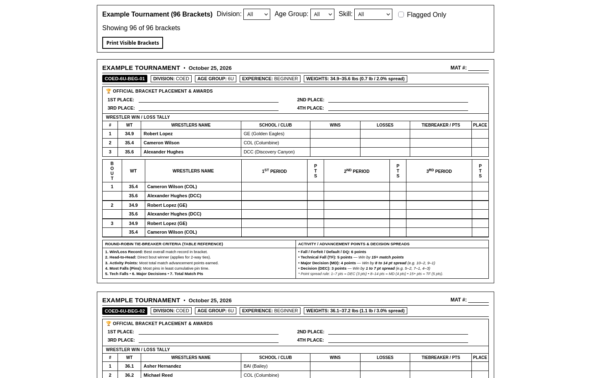
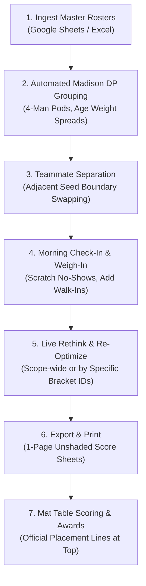

<div align="center">



# Bracketman

**Modern Youth Wrestling Tournament Manager, Madison Grouping Engine & Printable Bracket Generator**

[]()
[]()
[](https://opensource.org/licenses/MIT)

</div>

---

## Overview

**Bracketman** is a lightweight, local-first wrestling tournament software designed for youth wrestling leagues, tournament directors, head table operators, and coaches. 

Built with Python and Streamlit, Bracketman eliminates the tedious manual spreadsheets, last-minute check-in scramble, and mismatched round-robins by automating wrestler ingestion, Madison weight grouping, teammate separation, live check-in scratches/walk-ins, and generating crisp 1-page printable score sheets.

### Why Coaches and Directors Love Bracketman

1. **Zero Cloud Lock-in / Works 100% Offline**: Runs locally on your laptop at the gym table. No internet connection is required during the tournament.
2. **Secure Local-Only by Default**: Binds to `127.0.0.1` so uninvited devices on the gym Wi-Fi cannot connect or alter tournament brackets.
3. **Automated Madison Weight Grouping**: Uses dynamic programming to partition wrestlers into optimal 4-person round-robin pods (target 4, acceptable 3–5) while strictly enforcing age-specific weight spread limits.
4. **Teammate Separation**: Boundary-swap heuristics detect wrestlers from the same school or club and swap adjacent seeds to avoid teammates facing each other in round-robins.
5. **Live Check-In Scratches & Walk-Ins**: Handle morning check-in changes in seconds. Scratch no-shows (with 1-click restore) and add walk-ins with intelligent pod fit scoring.
6. **Clean, Unshaded 1-Page Printable Score Sheets**: High-contrast, black-and-white score sheets formatted specifically for table workers and awards. Fits cleanly on a single 8.5" x 11" sheet.

---

## Application Walkthrough & Features

Bracketman features an intuitive tabbed interface designed for high-stress tournament environments:

### 1. 🏆 Brackets Explorer

Browse, inspect, and verify all brackets in real time. Use multi-select filters for Division (`Coed`, `Girls`), Age Group (`6U`, `8U`, `10U`, `12U`, `15U`), Skill Level (`Beginner`, `Advanced`), or text search for any wrestler or club.



- **Tournament Summary Metrics**: Instant visibility into total registered wrestlers, total brackets generated, flagged brackets (exceeding weight spread thresholds), and teammate conflicts.
- **Bracket Cards**: Each pod displays wrestler seeds, actual scale weights, clubs, computed weight spread %, and full round-robin bout schedules (e.g. Bout 1: 1 vs 4, Bout 2: 2 vs 3).
- **Visual Alert Badges**: Instantly highlights pods that need attention (e.g., solo stragglers or >10% weight spread).

---

### 2. 🛠️ Tweak & Regenerate by ID

The nerve center for mat-side tournament day adjustments. Manage check-in walk-ins, scratches, bracket re-optimizations, and manual adjustments without ever editing a spreadsheet.



- **❌ Scratch No-Show Wrestler**:
  - Remove a no-show wrestler from an individual bracket or both divisions if dual-entered.
  - Bout schedules automatically recalculate for remaining wrestlers.
  - Scratch history is preserved with 1-click **Restore Wrestler** capability.
- **➕ Add Walk-In Wrestler**:
  - Enter wrestler name, exact scale weight, age group, and skill tier.
  - The algorithm calculates a **Suitability Fit Score** across existing brackets based on weight spread %, teammate conflicts, and pod capacity, or allows spinning off an entirely new bracket.
- **🔄 Refresh & Rethink Brackets**:
  - **Scope-Wide Rethink**: Re-partition an entire age group (e.g., all `Coed 8U`) or the entire tournament over all active wrestlers while protecting locked brackets.
  - **Targeted Selection by ID**: Select specific bracket IDs (e.g., `COED-8U-BEG-01` and `COED-8U-BEG-02`) to merge and rebuild just those pods after scratches.
  - **Rule Overrides**: Optionally relax maximum weight spread limits or allow beginner/advanced cross-pooling for low-turnout age brackets.
- **Manual Hand-Tweaks**:
  - **Move Wrestler**: Shift a wrestler into an adjacent pod or spin them into a new bracket.
  - **Swap Wrestlers**: 1-click trade between wrestlers across two brackets.
  - **Merge Brackets**: Merge underfilled pods directly from built-in advisor prompts.
  - **Edit Wrestler Details**: Correct typos, modify check-in scale weights, or reassign club affiliations on the fly.
  - **Lock / Unlock**: Freeze finalized brackets so automated re-optimizations never touch them.

---

### 3. 📥 Sheet Import & Sync

Ingest team rosters from Google Spreadsheets or local Excel/CSV files in seconds.



- **Google Sheet Link Support**: Paste any standard Google Sheet URL or key. Bracketman extracts the ID and fetches all public team tabs automatically.
- **Preamble Header Detection**: Intelligently skips coaching instructions, disclaimers, or empty preamble rows at the top of sheets to find the actual table headers (`Wrestler Name`, `Weight`, `Age`, `Experience`, etc.).
- **Dual-Entry Recognition**: Automatically detects wrestlers participating in both Beginner and Advanced tiers or Coed and Girls divisions.
- **Sync Modes**:
  - **Sync & Preserve**: Updates weights and adds new wrestlers while leaving your hand-tweaked and locked brackets completely untouched.
  - **Full Overwrite**: Re-imports the entire roster from scratch and rebuilds all brackets fresh.

---

### 4. 🖨️ Print & Export

Generate print-ready materials and export data for coaches, head tables, and league archives.



- **Multi-Format Downloads**:
  - **Printable HTML Sheets**: Standalone HTML document formatted for Chrome/Firefox print-to-PDF or direct paper printing.
  - **Multi-Tab Excel Workbook (`.xlsx`)**: Formatted workbook containing separate sheets for master roster, division summaries, and bout tables.
  - **CSV Export**: Flat file format for backup and database archiving.
- **Interactive Live Preview**: Filter and inspect the exact print sheet directly in the UI before sending it to the printer.

---

### 5. 📜 Audit Log

Complete accountability for head table staff and tournament directors.



- **Immutable Audit Trail**: Every scratch, walk-in, manual move, swap, weight edit, lock toggle, and re-optimization is logged with an exact timestamp.
- **Dispute Resolution**: If a coach asks why a wrestler moved brackets or was scratched, consult the audit log for the exact action history.

---

### 6. 📄 Official 1-Page Printable Score Sheet

Designed specifically based on official high school and youth wrestling tournament table requirements.



- **Header Section**: Prominent Tournament Name, Date, Division, Age Group, Experience Tier, Weight Range & Spread %, and a clear **`MAT #: _____`** fill line.
- **🏆 Official Placement & Awards Box**: Cleanly positioned at the top of the sheet with fill lines for **1st Place, 2nd Place, 3rd Place, and 4th Place** awards presentation.
- **Wrestler Win/Loss Tally Table**: Tracks Seed #, Scale Weight, Wrestler Name, School / Club, Wins, Losses, Tiebreaker / Points, and Final Place.
- **Bout Score Table (Unshaded)**: Crisp, high-contrast black borders with distinct thick divider lines between bouts. No gray ink shading to waste printer toner. Columns for `1ST PERIOD`, `PTS`, `2ND PERIOD`, `PTS`, `3RD PERIOD`, and `PTS`.
- **Round-Robin Tiebreaker & Activity Points Reference**: Complete table-side reference at the bottom explaining:
  - 1. Win/Loss Record &bull; 2. Head-to-Head &bull; 3. Activity Points &bull; 4. Most Falls (Pins) &bull; 5. Tech Falls &bull; 6. Major Decisions &bull; 7. Total Match Pts.
  - Scoring breakdown: Fall/Forfeit (6 pts), Tech Fall (5 pts, 15+ pt margin), Major Decision (4 pts, 8–14 pt margin), Decision (3 pts, 1–7 pt margin).
- **Single Page Guarantee**: Engineered using `@page { size: letter portrait; margin: 0.25in 0.3in; }` and CSS flex containment to ensure every bracket fits onto exactly one sheet of paper without spilling over.

---

## Weight Grouping & Teammate Logic

Bracketman implements a mathematically optimal Madison weight grouping pipeline:

1. **Normalization**:
   - Ages normalized to `4U`, `6U`, `8U`, `10U`, `12U`, and `15U` (`14U` aliased into `15U`).
   - Divisions parsed into `Coed` or `Girls`.
   - Experience classified into `Beginner` and `Advanced`.
2. **Target Pod Size & Natural Clusters**:
   - Target pod size is **4 wrestlers** (3 rounds, 6 bouts total).
   - If division count requires flexibility, pods of 3 or 5 are created. Single-wrestler pods (stragglers) are strictly prevented.
3. **Progressive Age-Scaled Weight Spread Limits**:
   Younger wrestlers require tighter weight groupings than older wrestlers:
   - **6U**: 5% max recommended weight spread
   - **8U**: 7% max recommended weight spread
   - **10U**: 8% max recommended weight spread
   - **12U**: 10% max recommended weight spread
   - **15U**: 12% max recommended weight spread
4. **Boundary Swapping for Teammate Separation**:
   - If two wrestlers from the same school/club land in the same 4-man pod, Bracketman tests swapping boundary seeds with adjacent pods to separate teammates without violating weight limits.
5. **Cross-Skill Merging Advisor**:
   - When a solitary beginner or advanced wrestler cannot form a viable bracket, Bracketman provides one-click advisory merging into the adjacent experience tier.

---

## Installation & Setup

### System Prerequisites
Bracketman runs on **Linux, macOS, and Windows** with **Python 3.10+**.

#### Ubuntu / Debian / Raspberry Pi OS
```bash
sudo apt update
sudo apt install -y python3 python3-venv python3-pip git curl
```

#### Fedora / RHEL
```bash
sudo dnf install -y python3 python3-pip git curl
```

#### macOS (Homebrew)
```bash
brew install python git
```

---

### Quick Start Installation

```bash
# 1. Clone repository
git clone https://github.com/sengelbert/bracketman.git
cd bracketman

# 2. Set up virtual environment
python3 -m venv .venv
source .venv/bin/activate

# 3. Install dependencies in editable mode
pip install --upgrade pip
pip install -e .
pip install pytest selenium

# 4. Run automated tests to verify
pytest -v
```

All tests should pass in under a second (`13 passed in 0.15s`).

---

## Running the Application

### 1. Secure Local-Only Mode (Recommended for Tournaments)
When operating at a tournament venue or school gym Wi-Fi, run in default secure mode. This binds exclusively to `127.0.0.1`, guaranteeing that other computers on the gym Wi-Fi cannot access or tamper with your brackets:

```bash
bracketman ui
```
Open your browser to: **`http://localhost:8503`**

### 2. Home / Private LAN Mode
When preparing brackets at home and sharing access with other laptops or tablets on your private home network:

```bash
bracketman ui --lan
```
Streamlit will output your network address (e.g. `http://192.168.1.50:8503`).

### 3. Background Systemd Service (Head Table Linux Mini-PC)
For dedicated tournament kiosks or mini-PCs, Bracketman can run automatically on system boot:

```ini
# /etc/systemd/system/bracketman.service
[Unit]
Description=Bracketman Wrestling Tournament Manager
After=network.target

[Service]
Type=simple
User=simon
WorkingDirectory=/home/simon/bracketman
ExecStart=/home/simon/bracketman/.venv/bin/streamlit run src/bracketman/web/app.py --server.port 8503 --server.address 127.0.0.1 --server.headless true
Restart=on-failure
RestartSec=5s
Environment=PYTHONUNBUFFERED=1

[Install]
WantedBy=multi-user.target
```

Enable and start:
```bash
sudo systemctl daemon-reload
sudo systemctl enable --now bracketman
```

---

## Tournament Day Workflow



1. **Before Tournament**: Import your multi-team roster via **📥 Sheet Import & Sync**. Review brackets in **🏆 Brackets Explorer**.
2. **Morning Check-In**: Table staff report no-shows or new walk-ins. Go to **🛠️ Tweak & Regenerate by ID**:
   - Scratch no-shows with one click.
   - Enter walk-ins and assign them to recommended pods.
3. **Re-Optimize**: Click **⚡ Rethink & Re-Optimize Brackets** to rebalance affected divisions into clean 4-person brackets while preserving your locked brackets.
4. **Print & Distribute**: Go to **🖨️ Print & Export**, print the 1-page unshaded score sheets, and hand them to the table workers for each mat.
5. **Awards**: When a round-robin concludes, table workers fill in the top Official Placement & Awards box and deliver the sheet directly to the awards table.

---

## Automated Test Suite

Bracketman maintains strict test coverage over roster parsing, grouping algorithms, tiebreakers, persistence, and mat-side tweaks:

```bash
.venv/bin/pytest -v
```

Test coverage includes:
- `test_loader.py`: Google Sheet ID extraction, instruction preamble header detection, dual-entry parsing, and `.xlsx` roundtrips.
- `test_grouping.py`: Madison DP clustering, straggler prevention, teammate boundary swapping, and cross-skill fallback.
- `test_store.py`: Tournament persistence, manual moves/swaps, walk-in suitability scoring, scratches, and bracket re-optimization.
- `test_exporters.py`: HTML, multi-tab Excel, and CSV export generation.

---

## Contributing & License

Contributions, bug reports, and suggestions from wrestling coaches, tournament directors, and software developers are warmly welcome!

Distributed under the **MIT License**. Created with passion for youth wrestling communities.
