<div align="center">

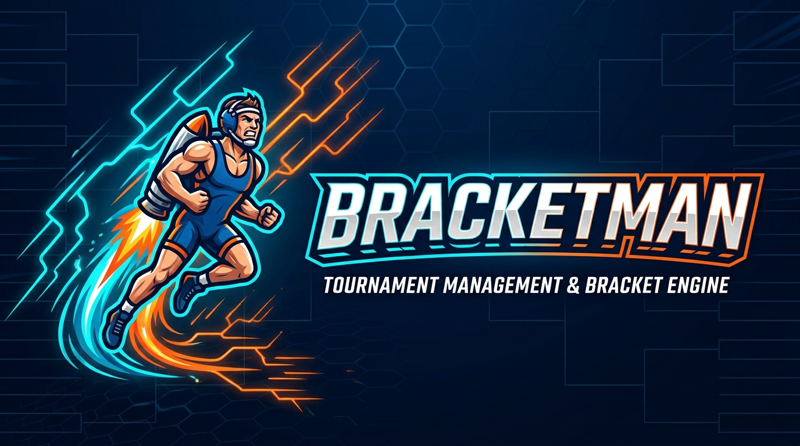

# Bracketman

**Modern Youth Wrestling Tournament Manager, Madison Grouping Engine & Printable Bracket Generator**

[]()
[]()
[](https://opensource.org/licenses/MIT)

</div>

---

## Overview

**Bracketman** is a lightweight, local-first wrestling tournament software designed for youth wrestling leagues, tournament directors, head table operators, and coaches. 

Built with Python and Streamlit, Bracketman eliminates the tedious manual spreadsheets, last-minute check-in scramble, and mismatched round-robins by automating wrestler ingestion, Madison weight grouping, early mat/table assignment, teammate separation, live check-in scratches/walk-ins, and generating crisp 1-page printable score sheets.

### Why Coaches and Directors Love Bracketman

1. **Zero Cloud Lock-in / Works 100% Offline**: Runs locally on your laptop at the gym table. No internet connection is required during the tournament.
2. **Secure Local-Only by Default**: Binds to `127.0.0.1` so uninvited devices on the gym Wi-Fi cannot connect or alter tournament brackets.
3. **Automated Madison Weight Grouping**: Uses dynamic programming to partition wrestlers into optimal 4-person round-robin pods (target 4, acceptable 3–5, or Best 2-of-3 for 2-person brackets) while strictly enforcing age-specific weight spread limits.
4. **Early Mat / Scoring Table Assignment (`Mat 1 .. Mat N`)**: Configure your gym's **Mat Count** and automatically balance brackets and kids across mats before the session starts—keeping contiguous weight classes in each age group together while balancing total bouts per table.
5. **Teammate Separation**: Boundary-swap heuristics detect wrestlers from the same school or club and swap adjacent seeds to avoid teammates facing each other in round-robins.
6. **Live Check-In Scratches, Walk-Ins & Wrestler Lookup**: Handle morning check-in changes in seconds. Search any wrestler instantly to see their assigned **Mat #**, bracket, and bouts, scratch no-shows (with 1-click restore), and add walk-ins with intelligent pod fit scoring.
7. **Clean, Unshaded 1-Page Printable Score Sheets, Blank Walk-In Sheets & Master Roster Handout**: High-contrast, black-and-white score sheets formatted specifically for table workers and awards—with pre-printed **`MAT #`** badges, optional top bracket progression diagram (or **Bout Sheet Only** mode with larger fonts & taller period boxes), match scoring point codes, printable blank write-in bracket sheets, and an interactive **Master Wrestler & Mat Directory Handout** (`roster_directory.html`) with 6 switchable views (`A–Z`, `Check-In by Age Group & Club`, `By Bracket ID`, `By Mat #`, `By Club`, `By Division & Age`).
8. **Division Uniqueness Guardrail & `NO MATCH` Status**: Strictly guarantees every wrestler is in at most **1 Coed** and **1 Girls** bracket across the tournament, automatically preventing duplicate division placements and cleanly marking unmatched dual-entry wrestlers as **`NO MATCH`** (`⚪ No Match`) rather than `Scratched`.
9. **Built-In Contextual Guidance & Tooltips**: Expandable workflow guides, skipped-row diagnostics, and hover tooltips across every tab ensure volunteer table workers can operate the app with zero prior training.

---

## Application Walkthrough & Features

Bracketman features an intuitive 6-tab interface designed for high-stress tournament environments:

### 1. 🏆 Brackets Explorer

Browse, inspect, and verify all brackets and mat assignments in real time. Filter by Division (`Coed`, `Girls`), Age Group (`6U`, `8U`, `10U`, `12U`, `15U`), Skill Level (`Beginner`, `Advanced`), **Mat #** (`Mat 1 .. Mat N`), or text search for any wrestler, club, or mat.

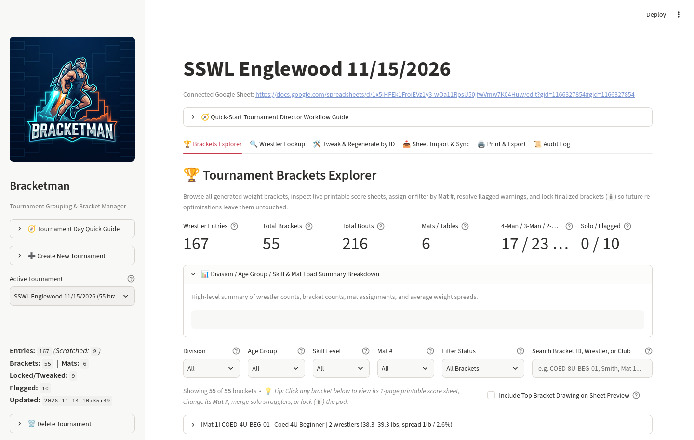

- **Tournament Summary & Mat Load Metrics**: Instant visibility into total registered wrestlers, total brackets, configured mats/tables, assigned mats per age group, and flagged pods.
- **Bracket Cards & Inline Mat Assignment**: Each pod displays its assigned **`[Mat N]`** badge, wrestler seeds, actual scale weights, clubs, computed weight spread %, and full round-robin bout schedules—plus a 1-click inline **Mat #** selector to move any bracket to another table.
- **Visual Alert Badges**: Instantly highlights pods that need attention (e.g., solo stragglers or >10% weight spread).

---

### 2. 🔍 Wrestler Lookup & Mat-Side Quick Actions

Instant wrestler-centric search across all active and scratched entries in the tournament:

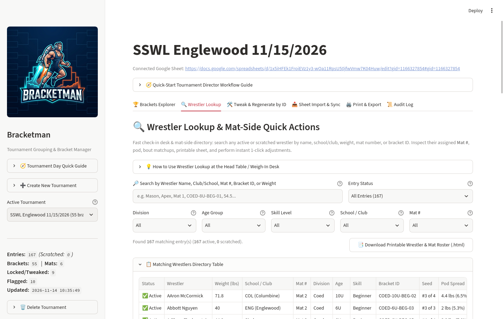

- **Multi-Faceted Search & Filtering**: Search by wrestler name, school/club, scale weight, **Mat #** (e.g., `Mat 1`), or bracket ID, and filter by status (`Active`, `Scratched`, `No Match`, `In Flagged Brackets`, `Dual-Entry`), division, age group, skill tier, club, or **Mat #**.
- **Complete Wrestler Profile Cards**: View the wrestler's assigned **`🏟️ Mat #`**, bracket ID, seed #, pod roster, weight spread %, scheduled bouts (with opponent weights and weight differences), and a collapsible 1-page printable bracket sheet preview.
- **Inline Mat-Side Quick Actions**: Edit scale weight, name, club, **division**, **age group**, or **skill level** in-place, move the wrestler to another bracket (ranked by suitability fit score with `[Mat N]` badges and division uniqueness protection), scratch a no-show, restore a scratched wrestler, or place a **`NO MATCH`** entry directly into any existing same-division bracket (without affecting their other division bracket) with 1 click.

---

### 3. 🛠️ Tweak & Regenerate by ID

The nerve center for mat-side tournament day adjustments. Manage check-in walk-ins, scratches, bracket re-optimizations, mat load balancing, and manual adjustments without ever editing a spreadsheet.

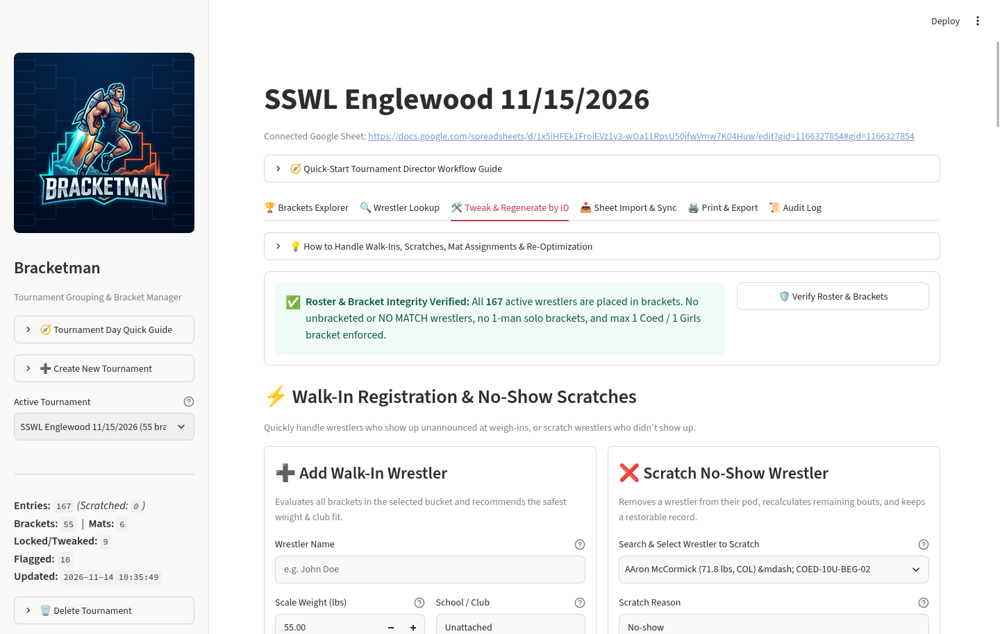

- **❌ Scratch No-Show Wrestler**:
  - Remove a no-show wrestler from an individual bracket or both divisions if dual-entered.
  - Bout schedules automatically recalculate for remaining wrestlers.
  - Scratch history is preserved with 1-click **Restore Wrestler** capability.
- **➕ Add Walk-In Wrestler**:
  - Enter wrestler name, exact scale weight, age group, and skill tier.
  - The algorithm calculates a **Suitability Fit Score** across existing brackets based on weight spread %, teammate conflicts, and pod capacity, or allows spinning off an entirely new bracket.
- **🔄 Refresh & Rethink Brackets**:
  - **Scope-Wide Rethink**: Re-partition an entire age group (e.g., all `Coed 8U`) or the entire tournament over all active wrestlers while protecting locked brackets.
  - **Targeted Selection by ID**: Select specific bracket IDs (e.g., `COED-8U-BEG-01` and `COED-8U-BEG-02`) to merge and rebuild just those pods after scratches.
  - **Rule Overrides**: Optionally relax maximum weight spread limits or allow beginner/advanced cross-pooling for low-turnout age brackets.
- **🛡️ Full Roster & Bracket Placement Verification**:
  - 1-click **🛡️ Verify Roster & Brackets** button at the top of the tab scans all registered and active wrestlers to guarantee that:
    1. **100% of wrestlers are in an active bracket** (zero unbracketed registered orphans).
    2. Any **NO MATCH** dual-entry/solo wrestlers without a safe weight-spread opponent are highlighted with their registration division, weight, and reason.
    3. Any **1-man solo brackets** (0 opponents / 0 scheduled bouts) are highlighted with quick-action links.
    4. **Division uniqueness** is strictly verified (every wrestler appears in at most 1 Coed and 1 Girls bracket, with 1-click duplicate resolution).
- **🏟️ Mat / Table Assignment & Load Balancer**:
  - **5 Auto-Assignment Strategies**: Set your tournament **Mat Count** (`1–24`) and distribute all brackets (or a specific division/age/skill session) across `Mat 1 .. Mat N` using:
    1. **Coed by Age + All Girls Grouped Together**: Pools all `Girls` brackets across age groups so they wrestle together while distributing each `Coed` age group equally across mats.
    2. **Equal per Age Group across Mats**: Distributes an equal number of brackets (`±1`) per `(division, age_group)` across all mats while allocating `+1` remainders to the least-loaded mats.
    3. **Balanced Contiguous Blocks (Default)**: Keeps nearby weights in each age group on the same mat while balancing total bouts and routing remainder blocks to the least-loaded mats first.
    4. **Tournament-Wide Contiguous Blocks**: Partitions the entire tournament into `N` contiguous age/weight blocks (`Mat 1` = youngest/lightest .. `Mat N` = oldest/heaviest/Girls).
    5. **Round-Robin Alternating**: Cycles brackets `1 .. N` across mats in order.
  - **Targeted Bulk & Individual Mat Moves**: Filter brackets by source **Mat #** or **Age Group** and move selected brackets—or all matching brackets—to another mat in 1 click, while inspecting a live **Mat Load & Bout Distribution** table.
  - **Sticky / Locked Mat Preservation**: Adding walk-ins, scratching no-shows, or re-optimizing unlocked brackets preserves assigned mats so table packets never unexpectedly reshuffle.
- **Manual Hand-Tweaks**:
  - **Move Wrestler**: Shift a wrestler into an adjacent pod or spin them into a new bracket (automatically inheriting the closest-weight mat in that age group and blocking duplicate same-division entries).
  - **Swap Wrestlers**: 1-click trade between wrestlers across two brackets.
  - **Merge Brackets (2 or More)**: Fold 1, 2, or more source brackets into a single target bracket at once (with live combined wrestler count preview and division uniqueness validation), or merge underfilled pods directly from built-in advisor prompts.
  - **Edit Wrestler Details**: Correct typos, modify check-in scale weights, or reassign club affiliations on the fly.
  - **Lock / Unlock**: Freeze finalized brackets so automated re-optimizations never touch them.

---

### 4. 📥 Sheet Import & Sync

Ingest team rosters from Google Spreadsheets or local Excel/CSV files and configure your gym's **Mat Count** in seconds.

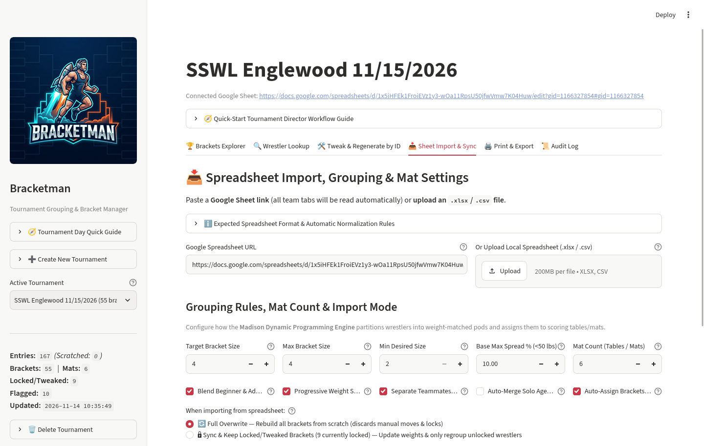

- **Google Sheet Link Support**: Paste any standard Google Sheet URL or key. Bracketman extracts the ID and fetches all public team tabs automatically.
- **Mat Count & Auto-Assignment**: Set **Mat Count (Tables / Mats)** right in the import settings (or update Mat Count without re-importing) so every bracket and wrestler is assigned to `Mat 1 .. Mat N` immediately.
- **Streamlined 5-Option Grouping Toggles**: Configure **Blend Beginner & Advanced (Avoid 1-Man & 2-Man Pods)** (which automatically handles both DP skill blending and post-DP solo-skill straggler absorption), **Progressive Weight Spread**, **Separate Teammates Across Pods**, **Auto-Merge Solo Age Stragglers**, and **Auto-Assign Brackets to Mats**.
- **Preamble Header Detection**: Intelligently skips coaching instructions, disclaimers, or empty preamble rows at the top of sheets to find the actual table headers (`Wrestler Name`, `Weight`, `Age`, `Experience`, etc.).
- **Skipped-Row Diagnostics**: Expandable diagnostic table inspects any skipped blank or incomplete rows by tab and row number.
- **Dual-Entry Recognition**: Automatically detects wrestlers participating in both Beginner and Advanced tiers or Coed and Girls divisions.
- **Sync Modes**:
  - **Sync & Preserve**: Updates weights and adds new wrestlers while leaving your hand-tweaked and locked brackets completely untouched.
  - **Full Overwrite**: Re-imports the entire roster from scratch and rebuilds all brackets fresh.

---

### 5. 🖨️ Print & Export

Generate print-ready materials (all at once or filtered per **Mat #** for each scoring table), blank walk-in bracket sheets, and export data for coaches, head tables, and league archives.

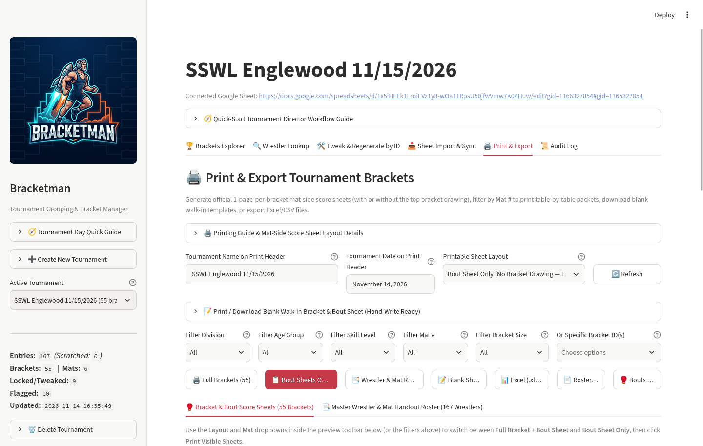

- **Multi-Format Downloads & Per-Mat Packet Filtering**:
  - **Filter by Mat #, Bracket Size, Division, Age, Skill, or Specific Bracket IDs**: Select `Mat 1`, `2-Man`, `≤2-Man`, `Coed 8U`, or specific Bracket IDs in **🖨️ Print & Export** (or inside the interactive HTML print toolbars) to print or save dedicated packets. All downloaded and saved files use clean lowercase underscore-delimited filenames (`example_tournament_brackets_mat_1_coed_8u.html`).
  - **Printable HTML Score Sheets (`brackets.html`)**: Standalone HTML document formatted for Chrome/Firefox print-to-PDF or direct paper printing (1 page per weight class, with pre-printed **`MAT #`** badge, matching master handout dark-slate toolbar, real-time live search by name or bracket ID, bracket size filter, interactive `Full` vs. `Bout Sheet Only` layout switcher, and **Refresh**, **Save as PDF**, and **Save HTML** buttons next to **Print Visible Sheets** that dynamically sync `document.title` so browser PDF saves pre-fill a clean underscore filename matching your active view and filters).
  - **Master Wrestler & Mat Directory Handout (`roster_directory.html`)**: Print-ready check-in wall chart and coach/parent handout with **6 interactive views** (**Alphabetical A–Z**, **Check-In by Age Group & Club (`Age -> Club A–Z -> Wrestler A–Z`)** for age-group check-in tables, **Sorted by Bracket ID**, **Grouped by Mat #**, **Grouped by School / Club**, and **Grouped by Division & Age Group**), **default row sort by Bracket ID (`A–Z → Seed`)**, **Bracket Size filter** (`1-Man`, `2-Man`, `3-Man`, `4-Man`, `≤2-Man`, `≤3-Man`, `No Match`) & size sorting (`Small → Large` / `Large → Small`), a **⚠ Warnings/Merges Only** filter, **Refresh**, **Save as PDF**, and **Save HTML** buttons next to **Print Roster Handout** (auto-naming `.pdf` and `.html` files with clean underscores based on active view/filters), check-in boxes (`☐`), pod opponents, and prominent **`⚠` warning & allowed-merge pills** (`⚠ WT SPREAD`, `⚠ MERGED SKILL`, `⚠ MERGED AGE`, `⚠ MERGED DIV`, `⚠ SAME CLUB`, `⚠ SOLO WRESTLER`, `⚠ OVERSIZED`, `⚠ NO MATCH`).
  - **Blank Walk-In Bracket & Bout Sheet (`.html`)**: Printable 1-page hand-writable bracket & bout templates (4-Man Round-Robin, 3-Man Round-Robin, and 2-Man Best 2-of-3) for last-minute mat-side brackets.
  - **Multi-Tab Excel Workbook (`.xlsx`)**: Formatted workbook containing separate sheets for `Master_Roster` (with `Mat #` and `Warnings / Merges` columns), division summaries, and bout tables.
  - **CSV Export**: Flat file format for backup and database archiving (with `Mat #` on summary, roster, and bout schedules).
- **Interactive Live Preview**: Filter and inspect the exact print sheet, master roster directory handout, or blank walk-in sheet directly in the UI before sending it to the printer.

---

### 6. 📜 Audit Log

Complete accountability for head table staff and tournament directors.

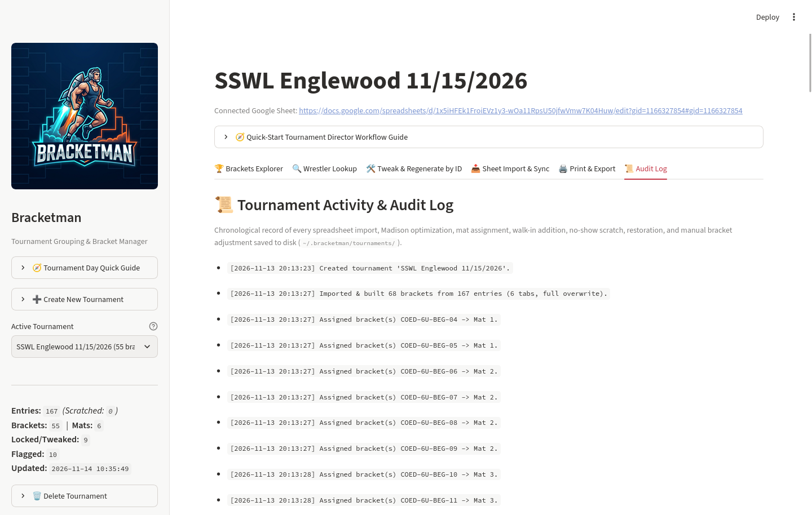

- **Immutable Audit Trail**: Every scratch, walk-in, manual move, swap, weight edit, lock toggle, mat assignment, and re-optimization is logged with an exact timestamp.
- **Dispute Resolution**: If a coach asks why a wrestler moved brackets or was scratched, consult the audit log for the exact action history.

---

### 7. 📄 Official 1-Page Printable Score Sheet, Bout-Sheet-Only Layout & Blank Walk-In Sheet

Designed specifically based on official high school and youth wrestling tournament table requirements, with **two 1-page printable layout modes** (**Full Bracket + Bout Sheet** or **Bout Sheet Only — No Bracket Drawing**).

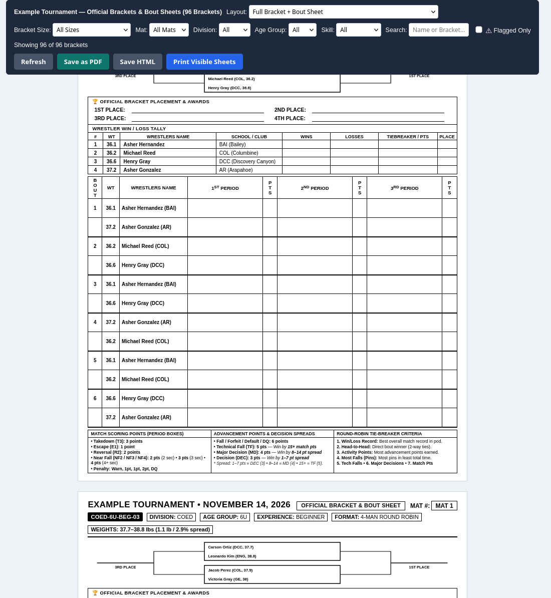

- **Header Section**: Prominent Tournament Name, Date, Division, Age Group, Experience Tier, Weight Range & Spread %, and a bold pre-printed **`MAT 1` .. `MAT N`** badge (or a `MAT #: _____` write-in line if unassigned).
- **Symmetric Bracket Diagram (Above Placement & Awards in Full Mode)**:
  - **3–4 Wrestler Pods**: Clean, unboxed vector bracket tree showing Round 1 matchups in two center boxes, with consolation arms extending left to **3RD PLACE** and championship arms extending right to **1ST PLACE** (labels placed *underneath* the horizontal lines so advancing wrestler names can be written cleanly on top of each line).
  - **2-Wrestler Pods (`Best 2 out of 3`)**: Dedicated **BEST 2 OUT OF 3 SERIES** bracket graphic showing `BOUT 1`, `BOUT 2`, and `BOUT 3* (IF SPLIT 1-1)` boxes in the center with **2ND PLACE** on the left and **1ST PLACE (2 OF 3)** on the right, plus all 3 bouts in the score table.
- **📋 Bout Sheet Only Mode (Default — No Bracket Drawing — Larger Fonts & Taller Period Boxes)**:
  - Since round-robin standings are tracked in the **Wrestler Win / Loss Tally** table and **Official Placement & Awards** box, **Bout Sheet Only** is now the default layout for bracket printouts and previews (and you can switch back to **Full Bracket + Bout Sheet** anytime via the **Printable Sheet Layout** selector in the app or the **Layout** dropdown in the HTML print toolbar). Removing the top bracket drawing redistributes vertical space into **larger fonts (`10.5px–16px`)**, taller W/L tally rows (`20px`), and **taller (`42px`) period scoreboxes** (`84px` per bout pair) while staying strictly within 1 US Letter page:

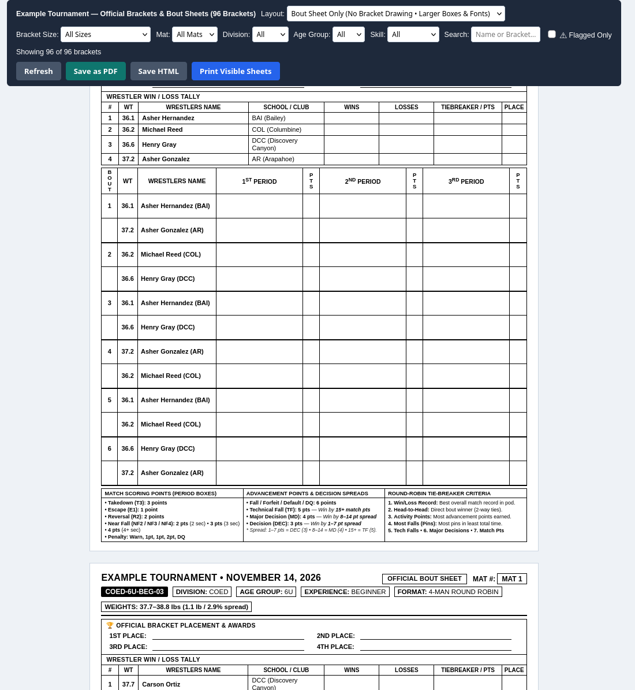

- **🏆 Official Placement & Awards Box**: Positioned directly above the W/L tally table with fill lines for **1st Place, 2nd Place, 3rd Place, and 4th Place** awards presentation.
- **Wrestler Win/Loss Tally Table**: Tracks Seed #, Scale Weight, Wrestler Name, School / Club, Wins, Losses, Tiebreaker / Points, and Final Place.
- **Bout Score Table (Unshaded, Double-Height & Extra-Wide Period Boxes)**: Crisp, high-contrast black borders with `38px` tall period cells in Full mode (`42px` in Bout-Sheet-Only mode) and a slimmed Wrestlers Name column (`18.5%`) so the 3 Period scoreboxes (`1ST PERIOD`, `2ND PERIOD`, `3RD PERIOD`) span **`61%` of the total page width**, giving table workers ample space to write live period scoring (`T3`, `E1`, `R2`, `NF2`, `NF3`, `NF4`, etc.).
- **3-Column Match Scoring, Advancement & Tie-Breaker Reference Box**: Complete table-side reference at the bottom:
  1. **Match Scoring Points (Period Boxes)** *(Left)*: Takedown (`T3` = 3 pts), Escape (`E1` = 1 pt), Reversal (`R2` = 2 pts), Near Fall (`NF2` = 2 pts / 2 sec, `NF3` = 3 pts / 3 sec, `NF4` = 4 pts / 4+ sec), Penalty (`Warn, 1pt, 1pt, 2pt, DQ`).
  2. **Advancement Points & Decision Spreads** *(Middle)*: Fall/Forfeit/Default/DQ (6 pts), Tech Fall (5 pts, 15+ pt spread), Major Decision (4 pts, 8–14 pt spread), Decision (3 pts, 1–7 pt spread).
  3. **Round-Robin Tie-Breaker Criteria** *(Far Right)*: 1. Win/Loss Record &bull; 2. Head-to-Head &bull; 3. Activity Points &bull; 4. Most Falls (Pins) &bull; 5. Tech Falls &bull; 6. Major Decisions &bull; 7. Match Pts.
- **Blank Walk-In Bracket & Bout Sheet**: Includes ready-to-print 1-page blank templates (4-Man Round-Robin, 3-Man Round-Robin, and 2-Man Best 2-of-3, in both Full and Bout-Sheet-Only layouts) with seed pairing hints (`#1 vs #4`, `#2 vs #3`, etc.) for writing in a quick bracket at the mat table:

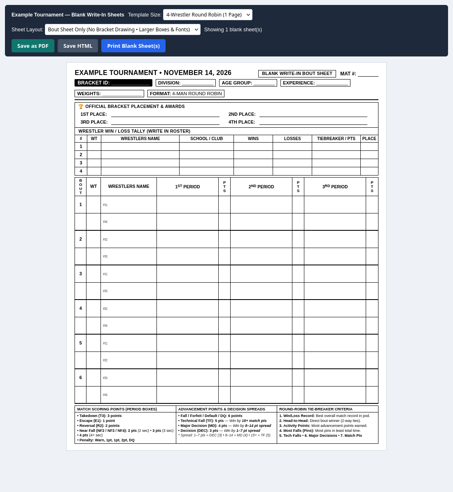

- **Master Wrestler & Mat Directory Handout**: Print-ready check-in wall chart and age/club check-in roster with Bracket ID default sorting, Bracket Size filtering, `⚠` warning/merge badges, and Refresh / Save as PDF / Save HTML toolbar controls:

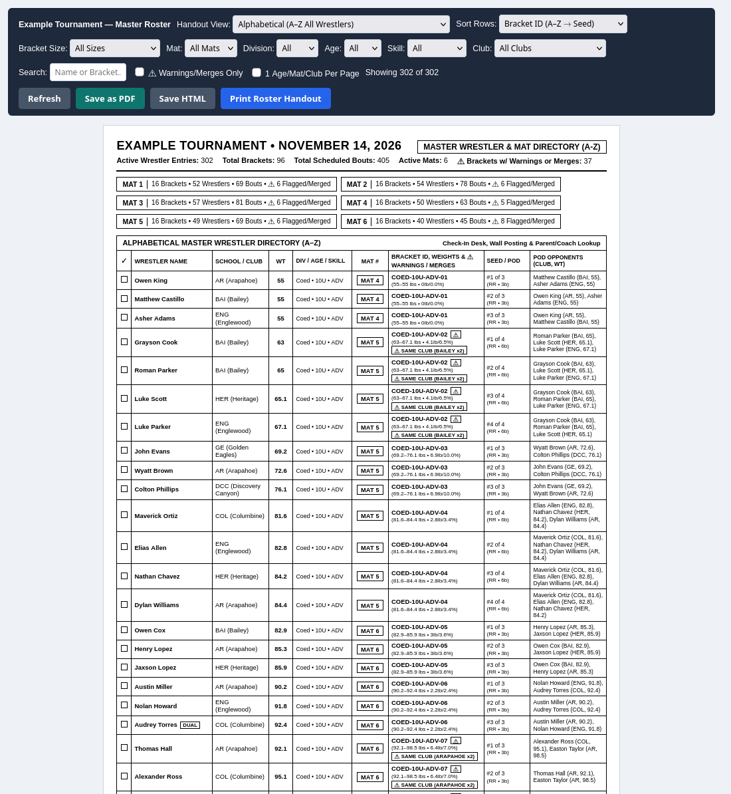

- **Single Page Guarantee**: Engineered using `@page { size: letter portrait; margin: 0.25in 0.3in; }` and CSS flex containment to ensure every bracket fits onto exactly one sheet of paper without spilling over.

---

## Weight Grouping & Teammate Logic

Bracketman implements a mathematically optimal Madison weight grouping pipeline:

1. **Normalization**:
   - Ages normalized to `4U`, `6U`, `8U`, `10U`, `12U`, and `15U` (`14U` aliased into `15U`).
   - Divisions parsed into `Coed` or `Girls` (with strict per-division uniqueness so no wrestler appears in more than 1 `Coed` and 1 `Girls` bracket).
   - Experience classified into `Beginner` (`Novice` aliased) and `Advanced` (`Experienced`/`Open` aliased).
2. **Target Pod Size & Natural Clusters**:
   - Target pod size is **4 wrestlers** (3 rounds, 6 bouts total), with 3-wrestler round-robins (3 bouts) or 2-wrestler **Best 2-of-3** series when weights require. Single-wrestler pods (stragglers) are strictly prevented whenever a valid merge exists.
3. **Progressive Weight-Scaled Spread Limits**:
   Allowed weight spread scales dynamically as wrestler weight increases (`progressive_spread: true` in [`configs/default.yaml`](configs/default.yaml)):
   - **`< 50 lbs`**: up to **10.0%** (`~3.0–4.9 lbs`)
   - **`50–74.9 lbs`**: up to **11.0%** (`~5.5–8.2 lbs`)
   - **`75–104.9 lbs`**: up to **12.0%** (`~9.0–12.5 lbs`)
   - **`105–134.9 lbs`**: up to **13.5%** (`~14.2–18.2 lbs`)
   - **`135+ lbs`**: up to **15.0%** (`~20.3–25+ lbs`)
   - *Girls division includes an additional **+2.0%** base spread buffer (`12.0%` base) to accommodate sparser upper weights.*
4. **Unified Priority Hierarchy (`Division [Locked] > Weight > Age > Skill > Team`)**:
   - When `blend_skills_to_fill_brackets: true` (enabled by default), high-density weight clusters stay pure `Beginner` or `Advanced`, while sparse weights automatically blend `Beginner` + `Advanced` within the same age group to form 3–4 wrestler brackets instead of 2-man brackets, tagging merged pods with `⚠ MERGED SKILL`.
5. **Boundary Swapping for Teammate Separation**:
   - If two wrestlers from the same school/club land in the same pod, Bracketman tests swapping boundary seeds with adjacent pods to separate teammates without violating weight limits.
6. **Same-Mat & Same-Division Straggler Merging + `NO MATCH` Handling**:
   - Solo straggler merge recommendations prioritize candidate brackets on the **same mat** and within the **same division**. If an unmatched dual-entry wrestler has no compatible opponent within weight spread in their second division, that entry is marked **`NO MATCH`** (`⚪ No Match`) rather than `Scratched`.

---

## Installation & Setup (`.venv` Recommended)

A standard Python virtual environment (**`.venv`**) is the **recommended way to install and run Bracketman** across all platforms (Linux, Windows, and macOS). It runs natively with minimal memory (~50 MB RAM), zero virtual machine overhead, and instant startup.

### 1. System & Software Requirements by Platform

| Requirement | Fedora / RHEL | Ubuntu / Debian / Pi OS | Windows 10 / 11 (64-bit) | macOS 12+ (Apple Silicon & Intel) |
| :--- | :--- | :--- | :--- | :--- |
| **Python ($\ge 3.10$)** | `python3` (`dnf`) | `python3` (`apt`) | [python.org](https://www.python.org/downloads/windows/) or `winget` *(check **"Add python.exe to PATH"**)* | [Homebrew](https://brew.sh/) (`brew install python`) or [python.org](https://www.python.org/downloads/macos/) |
| **Virtual Env & Pip** | `python3-pip` (`venv` built-in) | `python3-venv` & `python3-pip` | Built into official Python installer | Built into Homebrew / python.org installer |
| **Git** *(or ZIP download)* | `git` (`dnf`) | `git` (`apt`) | [git-scm.com](https://git-scm.com/download/win) or `winget` | `git` (`brew` or Xcode CLI tools) |
| **Web Browser** | Firefox / Chrome | Firefox / Chromium | Edge / Chrome / Firefox | Safari / Chrome / Firefox |
| **C++ Build Tools** | **None required** | **None required** | **None required** | **None required** |

#### Python Package Dependencies (Auto-Installed into `.venv`)
All Python packages are defined in [`pyproject.toml`](pyproject.toml) and [`requirements.txt`](requirements.txt) and use pre-built binary wheels (zero compilation needed):
- **Core**: `streamlit>=1.30`, `click>=8.0`, `PyYAML>=6.0`, `requests>=2.28`
- **Dev / Testing** (`pip install -e ".[dev]"`): `pytest>=7.0`
- **Excel / `.xlsx` Engine**: 100% pure Python stdlib (`zipfile` + `xml.etree.ElementTree`) — no external C/C++ spreadsheet libraries required.

---

### 2. Platform-by-Platform `.venv` Setup & Launch

#### 🐧 Fedora / RHEL Linux
```bash
# 1. Install system prerequisites
sudo dnf install -y python3 python3-pip git curl

# 2. Clone repository
git clone https://github.com/sengelbert/bracketman.git
cd bracketman

# 3A. Automated .venv setup & test verification
./scripts/setup_fedora.sh

# 3B. Or manual .venv setup
python3 -m venv .venv
source .venv/bin/activate
pip install --upgrade pip setuptools
pip install -e ".[dev]"
pytest -v

# 4. Launch on localhost (http://127.0.0.1:8503)
bracketman ui
```

#### 🐧 Ubuntu / Debian / Raspberry Pi OS
```bash
# 1. Install system prerequisites (note: python3-venv is a separate package on Debian/Ubuntu)
sudo apt update
sudo apt install -y python3 python3-venv python3-pip git curl

# 2. Clone repository
git clone https://github.com/sengelbert/bracketman.git
cd bracketman

# 3. Create .venv & install dependencies
python3 -m venv .venv
source .venv/bin/activate
pip install --upgrade pip setuptools
pip install -e ".[dev]"
pytest -v

# 4. Launch on localhost (http://127.0.0.1:8503)
bracketman ui
```

#### 🪟 Windows 10 / 11
1. **Install Prerequisites**:
   - Install **Python 3.10+** from [python.org](https://www.python.org/downloads/windows/) (⚠️ check **"Add python.exe to PATH"** on the first installer screen) or run in PowerShell:
     ```powershell
     winget install Python.Python.3.12 Git.Git
     ```
2. **Option A — 1-Click `.venv` Bootstrap & Launch (Easiest)**:
   - Double-click **`run_bracketman.bat`** in File Explorer.
   - On first run, it automatically creates `.venv`, installs all packages, prepares the example tournament, and opens your browser to `http://localhost:8503`.
3. **Option B — PowerShell Automated Setup Script**:
   ```powershell
   git clone https://github.com/sengelbert/bracketman.git
   cd bracketman
   .\scripts\setup_windows.ps1
   ```
4. **Option C — Manual `.venv` in PowerShell / Command Prompt**:
   ```powershell
   git clone https://github.com/sengelbert/bracketman.git
   cd bracketman
   python -m venv .venv
   .\.venv\Scripts\Activate.ps1
   pip install --upgrade pip setuptools
   pip install -e ".[dev]"
   pytest -v
   bracketman ui
   ```

#### 🍎 macOS (Apple Silicon M1–M4 & Intel)
1. **Install Prerequisites**:
   - macOS ships an older Xcode Python (3.9), so install **Python 3.10+** via [Homebrew](https://brew.sh/) or the official [python.org macOS installer](https://www.python.org/downloads/macos/):
     ```bash
     brew install python git
     ```
2. **Option A — 1-Click Finder Launch (Easiest)**:
   - Double-click **`run_bracketman.command`** in Finder.
   - Automatically finds Python 3.10+, creates `.venv`, installs dependencies, and opens your browser to `http://localhost:8503`.
3. **Option B — Automated Terminal Setup Script**:
   ```bash
   git clone https://github.com/sengelbert/bracketman.git
   cd bracketman
   ./scripts/setup_macos.sh
   ```
4. **Option C — Manual `.venv` in Terminal**:
   ```bash
   git clone https://github.com/sengelbert/bracketman.git
   cd bracketman
   python3 -m venv .venv
   source .venv/bin/activate
   pip install --upgrade pip setuptools
   pip install -e ".[dev]"
   pytest -v
   bracketman ui
   ```

---

### 3. Why `.venv` Is Preferred Over Docker / Podman

| Platform | Preferred Method | Why? |
| :--- | :--- | :--- |
| **Windows 10 / 11** | **Native `.venv`** (`run_bracketman.bat`) | Uses ~50 MB RAM, starts in 1 second, zero battery drain, and only requires Python. Docker/Podman on Windows requires WSL2 + a hidden Linux VM (2–4 GB RAM overhead). |
| **macOS** | **Native `.venv`** (`run_bracketman.command`) | Native Apple Silicon speed, instant startup, zero VM battery drain. Docker/Podman on macOS runs inside a Linux VM. |
| **Fedora / Linux** | **Native `.venv`** *(or Rootless Podman)* | Native `.venv` is lightweight, fast, and easy to manage directly or via `systemd`. Rootless Podman is also available as an optional alternative on Linux servers. |

---

## Running the Application

### 1. Secure Local-Only Mode (Recommended for Tournaments)
When operating at a tournament venue or school gym Wi-Fi, run in default secure mode. This binds exclusively to `127.0.0.1`, guaranteeing that other computers on the gym Wi-Fi cannot access or tamper with your brackets:

```bash
bracketman ui
```
Open your browser to: **`http://localhost:8503`** (or `http://127.0.0.1:8503`).

> [!NOTE]
> Streamlit telemetry and first-run prompts are pre-disabled via `.streamlit/config.toml` so the UI launches cleanly on fresh installations without terminal prompts.

### 2. Headless Mode (Servers, SSH Sessions & Background Daemons)
To start Bracketman without attempting to launch a local desktop browser window (ideal for SSH sessions, background daemons, mini-PCs, or automated workflows):

```bash
.venv/bin/bracketman ui --headless --port 8503 --host 127.0.0.1
```
*(Or simply `bracketman ui --headless` when `.venv` is activated. On Linux without `DISPLAY` or `WAYLAND_DISPLAY` set, `bracketman ui` automatically enables headless mode.)*

### 3. Home / Private LAN Mode
When preparing brackets at home and sharing access with other laptops or tablets on your private home network:

```bash
bracketman ui --lan
```
*(Can also be combined with headless mode: `bracketman ui --lan --headless`.)*
Streamlit will output your network address (e.g. `http://192.168.1.50:8503`).

### 4. CLI Commands Reference
Bracketman also provides a full command-line interface for headless batch processing and tournament management:

```bash
# Inspect a Google Sheet URL or local Excel/CSV file (counts by tab, division, age, skill)
.venv/bin/bracketman inspect data/example_tournament.xlsx

# Build brackets & export CSVs, multi-tab XLSX, printable brackets.html, and roster_directory.html
.venv/bin/bracketman build data/example_tournament.xlsx -o output --mats 4 --show-rosters

# Regenerate specific bracket IDs within a saved tournament
.venv/bin/bracketman regenerate example-tournament COED-8U-BEG-01 COED-8U-BEG-02

# Re-optimize all active unlocked brackets in a saved tournament (or specific division/age group)
.venv/bin/bracketman reoptimize example-tournament --division Coed --age-group 8U

# Generate a starter YAML configuration file
.venv/bin/bracketman init-config -o tournament_config.yaml
```

### 5. Optional: Background Systemd Service (Linux Kiosk / Mini-PC)

#### Option A: Unprivileged User Service (Recommended on Fedora / Ubuntu)
No `sudo` required. Uses your local `.venv`:

```bash
mkdir -p ~/.config/systemd/user
cp systemd/bracketman.service ~/.config/systemd/user/
systemctl --user daemon-reload
systemctl --user enable --now bracketman
```

Check status:
```bash
systemctl --user status bracketman
```

To keep the service running when you log out (headless mini-PC):
```bash
loginctl enable-linger $USER
```

#### Option B: System-wide Service (Root / Multi-User)
```ini
# /etc/systemd/system/bracketman.service
[Unit]
Description=Bracketman Wrestling Tournament Manager
After=network.target

[Service]
Type=simple
User=simon
WorkingDirectory=/home/simon/bracketman
ExecStart=/home/simon/bracketman/.venv/bin/bracketman ui --headless --port 8503 --host 127.0.0.1
Restart=on-failure
RestartSec=5s
Environment=PYTHONUNBUFFERED=1

[Install]
WantedBy=multi-user.target
```

Enable and start:
```bash
sudo systemctl daemon-reload
sudo systemctl enable --now bracketman
```

### 6. Optional: Podman / Docker Container (Linux Alternative)

If you prefer running inside a container on a Linux host (where containers run natively without a VM):

```bash
# Build image
podman build -t bracketman .

# Run strictly on localhost (with :Z for SELinux volume relabeling)
podman run -d --name bracketman \
  -p 127.0.0.1:8503:8503 \
  -v ./data:/app/data:Z \
  -v ./output:/app/output:Z \
  bracketman
```

Or using `podman compose` / `docker compose`:
```bash
podman compose up -d
```

Access at **`http://localhost:8503`**.

---

## Tournament Day Workflow

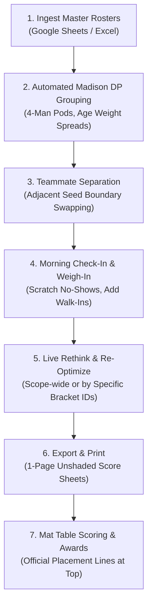

1. **Before Tournament**: Import your multi-team roster via **📥 Sheet Import & Sync**. Review brackets in **🏆 Brackets Explorer**.
2. **Morning Check-In**: Table staff report no-shows or new walk-ins. Go to **🛠️ Tweak & Regenerate by ID**:
   - Scratch no-shows with one click.
   - Enter walk-ins and assign them to recommended pods.
3. **Re-Optimize**: Click **⚡ Rethink & Re-Optimize Brackets** to rebalance affected divisions into clean 4-person brackets while preserving your locked brackets.
4. **Print & Distribute**: Go to **🖨️ Print & Export**, print the 1-page unshaded score sheets, and hand them to the table workers for each mat.
5. **Awards**: When a round-robin concludes, table workers fill in the top Official Placement & Awards box and deliver the sheet directly to the awards table.

---

## Automated Test Suite

Bracketman maintains strict test coverage over roster parsing, grouping algorithms, tiebreakers, persistence, and mat-side tweaks:

```bash
.venv/bin/pytest -v
```

Test coverage (21 automated tests) includes:
- `test_loader.py`: Google Sheet ID extraction, instruction preamble header detection, dual-entry parsing, and `.xlsx` roundtrips.
- `test_grouping.py`: Madison DP clustering, straggler prevention, teammate boundary swapping, cross-skill fallback, and priority skill blending (`Division [Locked] > Weight > Age > Skill > Team`).
- `test_store.py`: Tournament persistence, manual moves/swaps, walk-in suitability scoring, scratches, bracket re-optimization, wrestler search, mat load balancing/lookup, and division uniqueness enforcement (`NO MATCH` handling).
- `test_exporters.py`: Populated 1-page HTML score sheets, 2-man Best 2-of-3 series, blank walk-in bracket sheets, Bout-Sheet-Only layout (no bracket drawing), interactive Master Wrestler & Mat Directory Handout (`roster_directory.html`), multi-tab Excel (`Master_Roster`), and CSV export generation.

---

## Contributing & License

Contributions, bug reports, and suggestions from wrestling coaches, tournament directors, and software developers are warmly welcome!

Distributed under the **MIT License**. Created with passion for youth wrestling communities.
